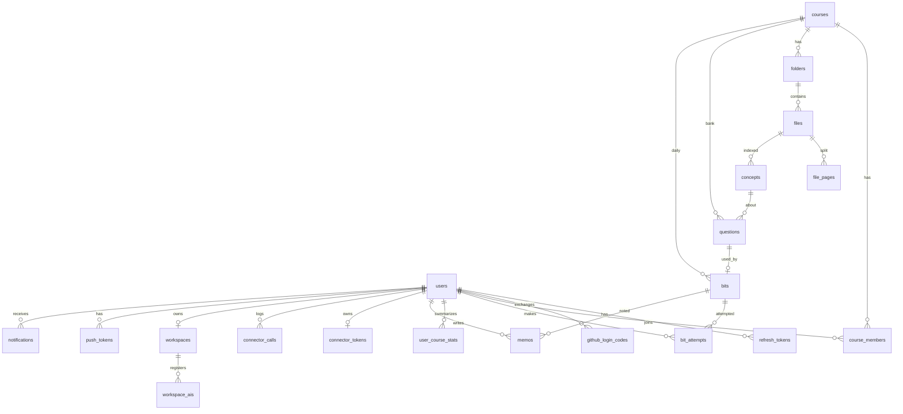

# DB 안내

Daybit DB(PostgreSQL 17)의 테이블 관계와 핵심 제약입니다. **실제 스키마는 Flyway 파일(`src/main/resources/db/migration`)이 기준**이며, 컬럼별 설명은 `V1__init.sql`의 주석에 있습니다. 이 문서는 팀 기획 문서의 `05_DB스키마`(2026-10-31)를 옮겨 온 것으로, 이후 변경은 이 문서에서만 관리합니다.

- 모든 테이블에 `created_at timestamptz default now()`가 있습니다.
- 데이터는 영구 보관합니다(P-DATA-01). 과목을 삭제하면 딸린 행은 `ON DELETE CASCADE`로 함께 지워집니다(P-DATA-02). 저장소(R2)에 올린 원본 파일의 삭제는 아직 연결하지 않았습니다.
- 상태 값은 문자열 + `check` 제약이며, API의 enum 값과 같은 소문자입니다.

## 관계도

## 테이블

| 영역 | 테이블 | 역할 | 사용 여부 |
|---|---|---|---|
| 계정 | `users` | 아이디 · GitHub 계정, 닉네임, 온보딩 시각. `login_id`와 `github_id` 중 하나는 필수 | 사용 중 |
| | `refresh_tokens` | 리프레시 토큰 해시, 만료 · 폐기 시각 (D2) | 사용 중 |
| | `github_login_codes` | GitHub 로그인 일회용 code 해시, 신규 가입 여부, 1분 만료 · 사용 시각 (D3, V2) | 사용 중 |
| 과목 | `courses` | 코드, 공개 여부, 시험일, 출제 범위, 퀴즈 출처, 상태(`active` · `ended`) | 사용 중 |
| | `course_members` | 멤버십과 가입 요청. `role`(`admin` · `co` · `member`), `status`(`active` · `pending`), `co_since`, `notify` | 사용 중 |
| 학습자료 | `folders` | `mid` · `final`(과목 생성 시 자동, 수정 · 삭제 불가), `custom` | 사용 중 |
| | `files` | 원본 위치, 페이지 수, 상태(`processing` · `ready` · `failed`), 업로드 동의 시각 | 사용 중 |
| | `file_pages` | 페이지별 추출 텍스트 · 이미지 (커넥터 `read_pages` · `search`) | 텍스트만 (이미지 미사용) |
| | `concepts` | 문제 은행용 개념 인덱스, 근거 페이지 범위, 출제 횟수 · 오답률 | 사용 중 |
| Bit | `questions` | 문제 은행. 보기(`jsonb`), 정답, 해설, 근거 파일 · 페이지, 출처, 검증 여부 | 사용 중 |
| | `bits` | 과목별 하루 한 문제. 번호, 출제일, 열림 · 마감 · 아카이브 시각, 마감 집계 | 사용 중 |
| | `bit_attempts` | 응시 기록. 서버 기록 시작 시각, 선택, 정답 여부, 점수 | 사용 중 |
| | `user_course_stats` | 과목별 연속 일수 · 정답 수 캐시. 제출 시 갱신 | 사용 중 |
| 기록 | `memos` | 아카이브 문제에 남기는 메모. 삭제는 표시 방식(`deleted_at`, `deleted_by`) | 사용 중 |
| AI 연결 | `connector_tokens` | 사용자당 커넥터 토큰 해시 1개 (원문 저장 안 함) | 미사용 |
| | `connector_calls` | 도구 호출 기록, 클라이언트 종류 | 미사용 |
| | `workspaces`, `workspace_ais` | 작업 공간 저장소, AI별 상태. 구독 토큰은 저장하지 않음 (P-AI-09) **[검증 필요]** | 출처 검증 조회만 |
| 알림 | `push_tokens` | FCM 기기 토큰, 플랫폼(`android` · `ios` · `web`) (D4) | 사용 중 |
| | `notifications` | 알림 기록. 종류(`bit_open` · `join_approved` · `promoted_admin` · `quiz_source_fallback`), `payload jsonb` | 사용 중 (기록 후 FCM 발송) |

## 핵심 제약

| 제약 | 의미 | 정책 |
|---|---|---|
| `courses.code` unique, `char(6)` | 과목 코드는 전체에서 유일 | P-COURSE-02 |
| `course_members` PK `(course_id, user_id)` | 한 사람은 과목당 멤버십 1개 (가입 요청 포함) | |
| `course_members_one_admin_uq` = `unique (course_id) where role = 'admin'` | 과목당 관리자 1명. 승계는 기존 관리자를 지운 뒤 승격 | P-ROLE |
| `bits` `unique (course_id, no)`, `unique (course_id, open_date)` | 과목 내 번호 유일, 하루 한 문제 (D5) | P-BIT-05 |
| `bit_attempts` PK `(bit_id, user_id)` | 한 Bit는 한 번만 응시 | P-BIT-09 |
| `connector_tokens` PK `user_id` | 사용자당 유효 토큰 1개 | P-AI-02 |

## 자주 쓰는 조회

| 용도 | 조건 |
|---|---|
| 강의실 타일 · 지난 강의 | `course_members.status = 'active'` and `courses.state = 'active'` / `'ended'` |
| 멤버십 확인 | `course_members.status = 'active'`인 행이 없으면 404 |
| 탐색 인기 · 새 과목 | `visibility = 'public'` and `state = 'active'`, 구독자 수 desc / `created_at` desc |
| 코드 검색 | `code = upper(:q)` (공개 여부 · 상태 무관) |
| 관리자 승계 대상 | `role = 'co'` order by `co_since` |
| 활동 없음 OFF 후보 | `state = 'active'` and `coalesce(last_upload_at, created_at) < now() - 14일` and 최근 14일 응시 0건 |

## 스키마 변경

새 파일 `V{n}__설명.sql`을 추가합니다. 이미 배포 DB에 적용된 파일은 수정하지 않습니다. Flyway가 체크섬 불일치로 서버 시작을 막습니다.
